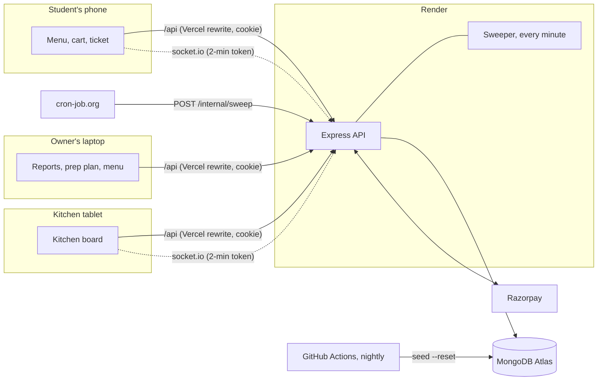

# Agla

Agla is pre-ordering for campus canteens. Students order from their phone, pick a 15-minute pickup slot and pay by UPI or at the counter. The kitchen cooks from a live board, and the student's token comes up when the food is ready. The canteen owner gets a prep plan that says how much of each batch dish to cook tomorrow, worked out from the last eight weeks of the same weekday.

"Agla!" is what the counter shouts in an Indian canteen: next.

- App: https://agla-lake.vercel.app
- API: https://agla-api.onrender.com/health (free tier: the first request after a quiet spell can take a minute while it wakes)
- Demo logins (password `agla-demo` for all three):
  - `student@demo.agla.app`: orders, live token, history
  - `kitchen@demo.agla.app`: the kitchen board, the counter, stock
  - `owner@demo.agla.app`: reports, prep plan, menu, team, hours

The demo canteen, Block C Canteen, holds eight weeks of generated orders, clearly a demo. It sells out of some batch dishes on busy days and throws food away on quiet ones, so the prep plan and reports have something real to work with. A nightly job rebuilds it, so the history always ends yesterday.

## Problem

Between classes, a campus canteen gets twenty minutes of everyone at once. Students queue to order, queue again to collect, and often give up and go hungry. The kitchen cooks blind: it doesn't know what's coming until people are at the counter, so food is either sold out by 1 pm or left over at closing.

The owner has the same blind spot over a longer stretch. Batch dishes like samosas, rajma chawal and thalis get made in the same quantity every day, busy Thursday or quiet Saturday. A day that sells out looks like a good day, but it hides how many more people wanted it.

## Who it's for

- **Students** who want food ready when their break starts, without standing in two queues.
- **Kitchen staff** who need one screen that says what to cook next, and a fast way to hand the right food to the right person.
- **Canteen owners and managers** who want fewer leftovers and fewer sell-outs, and a view of how the canteen is doing.

## Solution

Ordering ahead turns a rush into a schedule. Every order belongs to a pickup slot, and each slot holds only as many orders as the counter can hand over. The kitchen sees what's due in the next half hour, added up across orders, so food is cooked for a time instead of kept warm. Students collect by reading out a 4-digit code, so food can't go to the wrong person.

Because every order is recorded against a day, a slot and the stock left, Agla also knows what demand looked like, including on days a dish ran out. The prep plan uses that to suggest how much to cook.

## Key features

These are the workflows. Each one works end to end and is covered by the end-to-end test.

1. **Order with a pickup slot.** Browse the menu without an account and see how many plates of each batch dish are left. Add to the cart (it survives a refresh or a login detour), pick a slot (each shows how full it is), and pay now or at the counter. The server takes the plates and the slot atomically: when two students race for the last samosa, exactly one gets it. A double tap or a retried request can't create a second order.
2. **Live order and pickup.** The student's ticket shows the token on an LED-style board, the pickup code and the order's progress. It updates live, and when the food is ready the phone dings, buzzes and shows a notification. A student can cancel until cooking starts; paid orders refund automatically.
3. **The kitchen board.** Three columns (new, cooking, ready) of order slips sorted by pickup time, with late orders flagged. A strip on top adds up everything due in the next 30 minutes. One tap moves an order; two staff tapping at once can't move it twice. At the counter, staff tap in the student's code on a keypad, and counter orders show the amount to collect. Staff can mark a dish sold out, add more plates, cancel an order with a reason, or pause new orders during a rush.
4. **Prep plan.** For any of the next seven days, each batch dish shows the last eight same weekdays, with sold-out days marked. It suggests how many to make and shows, for whatever number the manager types, how often it would run out and how much would be left over. Saving the plan sets that day's stock. Details are under "How the prep plan works".
5. **Reports, menu and team.** Orders, money taken, on-time rate, missed pickups and food thrown away for the last 7, 14 or 30 days. Charts show orders per day, the busiest pickup times, what sells and daily waste, each with a table view. The menu editor, opening hours, slot length and capacity, and single-use staff invite links with manager and kitchen roles.

### The rules that keep it honest

- **Payment window.** An online order holds its slot and plates for 15 minutes while the student pays. If the payment doesn't finish, a background sweeper gives them back. A payment that arrives after that is refunded automatically.
- **No-shows.** Food left on the counter 45 minutes after its slot becomes a no-show. Two no-shows at a canteen in 30 days turns off paying at the counter there; prepaid orders still work.
- **Forgotten orders.** An order the kitchen never got to is cancelled and refunded an hour after its slot.
- **Refunds retry.** A refund that fails stays pending, and the sweeper retries it every minute.
- **Order limits.** At most 3 orders on the way per student per canteen, up to 10 different items and 10 of each.

## Tech stack

| Part | What | Why |
|---|---|---|
| App | React 19, Vite, Redux Toolkit, React Router | Redux holds what several screens share: login, carts (persisted to localStorage) and toasts |
| API | Node 22, Express 5, Mongoose | Express 5 forwards async errors on its own, so controllers stay short |
| Database | MongoDB Atlas | Conditional atomic updates (`findOneAndUpdate` with a filter on the current state) give race-free stock, slots and status changes without transactions |
| Live updates | Socket.io | Kitchen board, student tickets and open menus update without polling |
| Payments | Razorpay (test mode) | Checkout in the browser, signature check and refunds on the server |
| Charts and LED digits | Hand-written SVG | Full control over the seven-segment token display, sold-out markers and accessible table views |
| Background jobs | An in-process sweeper every minute, plus `POST /internal/sweep` for an outside cron | Expires unpaid checkouts, marks no-shows, drops forgotten orders, retries refunds |
| Hosting | Vercel (app), Render (API), Atlas (database), GitHub Actions (nightly demo rebuild) | Free tiers throughout |

## Architecture



**Request path.** The app calls `/api/...` on its own origin. Vercel rewrites that to the API, so the login cookie is first-party (`httpOnly`, `SameSite=Lax`). The socket connects straight to the API with a 2-minute token from `GET /api/auth/socket-token`, because the cookie isn't sent cross-site.

**Socket rooms.** `user:<id>` gets that student's order updates. `kitchen:<canteenId>` gets every order for the board, without pickup codes. `menu:<canteenId>` hears that stock or slots changed, so open menus refresh.

### Data model

| Collection | One document per | Holds |
|---|---|---|
| `users` | person | name, email, bcrypt password hash |
| `canteens` | canteen | hours, slot length and capacity, cooking lead time, open days, owner and staff with roles |
| `items` | menu item | price and cost in paise, veg, batch size (`dailyLimit`, null = made to order) |
| `stocks` | item per day | `made`, `sold`, `soldOutAt`. The live stock count and the sales history the prep plan reads |
| `days` | canteen per day | the token counter and how many orders each slot holds |
| `orders` | order | lines with name and price copied at order time, slot, status, pickup code, payment and refund state, a timestamp for each status |
| `invites` | staff invite | role, a SHA-256 hash of the link token, expiry, single use |

Money is stored in paise, so nothing rounds. Times are minutes after IST midnight (12:30 is 750), and calendar days are IST dates.

### The order lifecycle

```text
awaiting_payment → placed → preparing → ready → collected
        ↓             ↓          ↓         ↓
    cancelled     cancelled  cancelled   no_show
```

Every change goes through one function, `move()` in `server/utils/orders.js`. It updates the order only if it's still in an allowed status, so a change happens exactly once even when two requests race. Cancelling also gives back the slot and the plates, and starts a refund if the order was paid.

### Race-free stock and slots

Ordering reserves plates first and then the slot, each with a single conditional update:

```js
// A plate is taken only if enough are left. Two students racing for the last one: one update matches, one doesn't.
Stock.findOneAndUpdate({ item, day, $expr: { $lte: [{ $add: ["$sold", qty] }, "$made"] } }, { $inc: { sold: qty } });
// The slot hands out the token number in the same update that takes a place in it.
Day.findOneAndUpdate({ canteen, day, [`slots.${slot}`]: { $lt: capacity } }, { $inc: { [`slots.${slot}`]: 1, tokenSeq: 1 } });
```

If any step fails, everything taken so far is given back and the student is told exactly what ran out ("Only 3 Samosa left", "12:30 just filled up").

## How the prep plan works

For a batch dish on, say, Thursday, the plan looks at the last eight Thursdays the canteen traded.

1. **Demand, not sales.** On a day the dish didn't sell out, demand was what sold. On a day it did, demand was higher. Agla looks at that dish's normal days to see what share of its sales usually come in by the time it ran out. If samosas sell 55% of their day by 12:40 and they ran out at 12:40, demand was about sold / 0.55. Idli sells almost all before 9:30, so running out at 9:30 barely changes its estimate. (Capped at 3x.)
2. **Recent weeks count more.** Last week weighs 1, the week before 0.85, then 0.72 and so on.
3. **The right amount to make.** Making one plate too few loses its margin (price minus cost); one too many throws away its cost. The quantity that balances the two covers demand a share of the time equal to margin / price, the "newsvendor" critical ratio. A ₹15 samosa costing ₹6 should cover demand 60% of the time. The suggestion is that weighted quantile of the eight demands.
4. **Any number, explained.** The page shows, for whatever quantity the manager types, how often that would have run out and how much would be left over on those eight days.

The maths is in `server/utils/forecast.js` (pure functions, checked by `utils/forecast.check.js`), and the database side is `buildPlan()` in `server/controllers/plan.controller.js`.

### Results on the demo data

`node scripts/backtest.js` replays the last four weeks. Each day is planned only from data before it, then compared with what the canteen actually made: the same amount every day.

| Policy | Food thrown away | Item-days sold out | Margin lost to sell-outs (est.) | Total cost of wrong quantities |
|---|---:|---:|---:|---:|
| Same amount every day | ₹18,338 (1,025 plates) | 79 | ₹5,914 (273 plates) | ₹24,252 |
| Agla prep plan | ₹13,598 (742 plates) | 77 | ₹7,787 (355 plates) | ₹21,385 |

That's 26% less food thrown away and 12% less total cost, over 24 trading days and 216 batch item-days. On 79 of those item-days the canteen sold out, so their demand is estimated the same way the plan estimates it. That makes those numbers estimates, and the data itself is generated. The plan deliberately runs short a little more often on cheap, high-margin items, because for those a lost sale costs less than a tray of leftovers.

## Testing

```bash
cd server
npm test                      # end-to-end: real server, in-memory MongoDB, every workflow
node utils/forecast.check.js  # prep plan maths
```

The end-to-end test signs up an owner, a cook and two students, then walks every workflow. It covers the last-plate race, a full slot, idempotent retries, two staff tapping at once, the pickup code check, no-shows turning off counter payment, forged and late payments, refunds, the sweeper and the prep plan.

### Browser end-to-end test

`node e2e/browser.mjs` drives one headless Chromium with separate student, kitchen, owner and invitee contexts. It checks the real screens, live updates, races, phone layouts and console errors, and reconciles reports and reservations against MongoDB. It changes test data: use only a freshly seeded `agla_e2e` database.

```bash
MONGO_URI=mongodb://127.0.0.1:27018 MONGO_DB=agla_e2e node server/scripts/seed.js --reset
# In separate terminals, from server/ and client/ respectively:
PORT=8090 MONGO_URI=mongodb://127.0.0.1:27018 MONGO_DB=agla_e2e JWT_SECRET=e2e-secret CLIENT_URL=http://localhost:5190 INTERNAL_SECRET=e2e-internal node index.js
VITE_API_URL=http://localhost:8090 npx vite --port 5190 --strictPort
# From the repo root:
node e2e/browser.mjs
```

`BASE` and `API` override the default URLs (`http://localhost:5190` and `http://localhost:8090`); `MONGO_URI` overrides the test MongoDB address. The script launches Chromium from `/usr/bin/chromium` and imports a cached `playwright-core`; on another machine, change `executablePath` and the import in `e2e/browser.mjs`. Run with at least 40 minutes left in the IST day so several pickup slots are available. Screenshots and failure details go to `output/playwright/`. Real Razorpay checkout needs keys; without them, the suite checks the unavailable UI and stages waiting/refund ticket states. Reseed before another run.

## Local setup

You need Node 20+ and MongoDB (a local `mongod`, or a free Atlas cluster).

```bash
git clone https://github.com/adlakhavansh/agla.git && cd agla

# API
cd server
cp .env.example .env          # fill in MONGO_URI and the two secrets
npm install
npm run seed                  # demo canteen, 8 weeks of history, three demo logins
npm run dev                   # http://localhost:8080

# App, in a second terminal
cd client
cp .env.example .env.local
npm install
npm run dev                   # http://localhost:5173, /api proxied to the API
```

If port 8080 is taken, set `PORT` in `server/.env` and `VITE_API_URL` in `client/.env.local` to match; the dev proxy follows `VITE_API_URL`.

## Environment variables

**server/.env**

| Variable | Required | What |
|---|---|---|
| `MONGO_URI` | yes | MongoDB connection string |
| `MONGO_DB` | no | Database name, default `agla` |
| `JWT_SECRET` | yes | Signs login cookies and socket tokens; any long random string |
| `CLIENT_URL` | yes | Allowed app origins, comma-separated, e.g. `https://agla.vercel.app` |
| `INTERNAL_SECRET` | yes | Bearer token for `POST /internal/sweep` |
| `RAZORPAY_KEY_ID`, `RAZORPAY_KEY_SECRET` | no | Razorpay test keys. Without them online payment is off and students pay at the counter |
| `PORT` | no | Default 8080 |

**client/.env.local**

| Variable | What |
|---|---|
| `VITE_API_URL` | The API's own URL, used by the socket |

## Deployment

1. **Database.** Create a free MongoDB Atlas cluster and allow Render's outbound IPs (or `0.0.0.0/0` for a demo).
2. **API on Render.** New Blueprint from this repo (`render.yaml`). Set `MONGO_URI`, `CLIENT_URL` (the Vercel URL) and the Razorpay test keys.
3. **App on Vercel.** Import the repo with `client/` as the root. Set `VITE_API_URL` to the Render URL, and put the same URL in `client/vercel.json`'s `/api` rewrite.
4. **Sweeper cron.** On cron-job.org, call `POST https://<render-url>/internal/sweep` every 5 minutes with the header `Authorization: Bearer <INTERNAL_SECRET>`. That also keeps the free Render instance awake.
5. **Demo data.** Run `npm run seed` once against Atlas, and add `MONGO_URI` as a GitHub Actions secret so `refresh-demo.yml` rebuilds it nightly.

## Project structure

```text
server/
  controllers/   one file per area: auth, canteen, item, order, plan, report, team
  middlewares/   login, canteen roles (owner > manager > kitchen), errors
  models/        the seven collections above
  utils/         orders (state machine), reserve (stock and slots), sweeper, forecast, slots, time
  scripts/       seed (demo data), backtest (prep plan results)
  test.js        end-to-end test
client/src/
  pages/         student: Landing, Canteens, Menu, Ticket, Orders. Staff: Kitchen, Reports, PrepPlan, MenuEditor, Team, Settings
  components/    Segments (LED digits), Bars (charts), Header, Logo, VegMark
  store/         auth, carts, toasts
```
